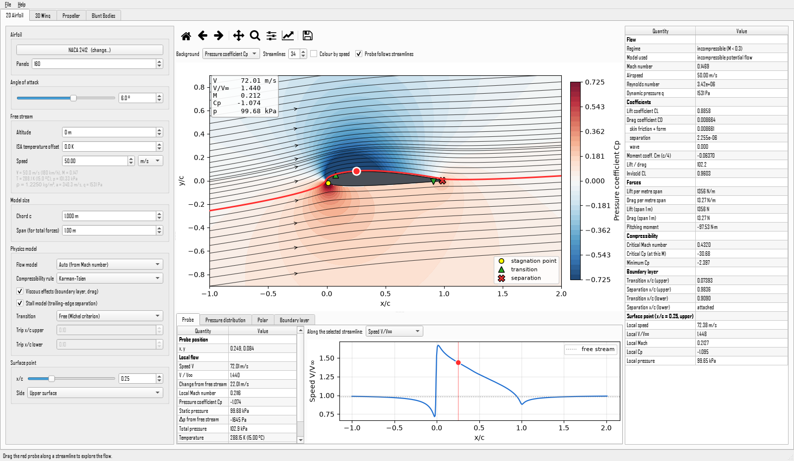
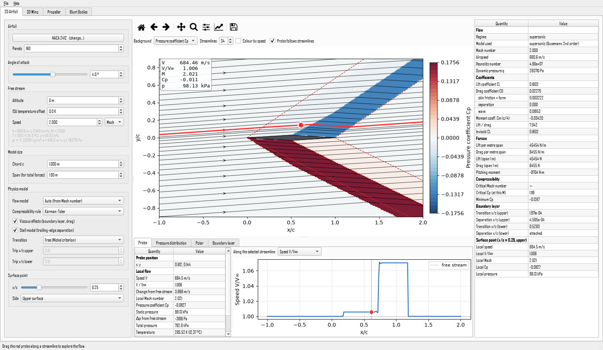
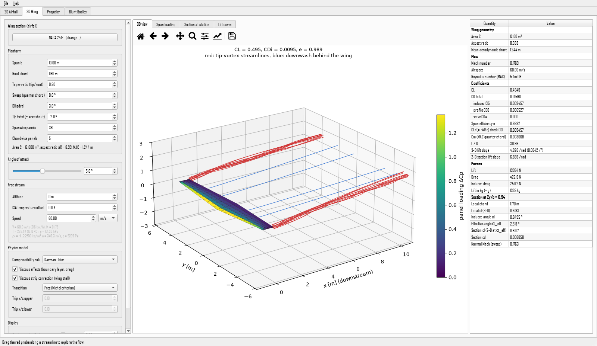
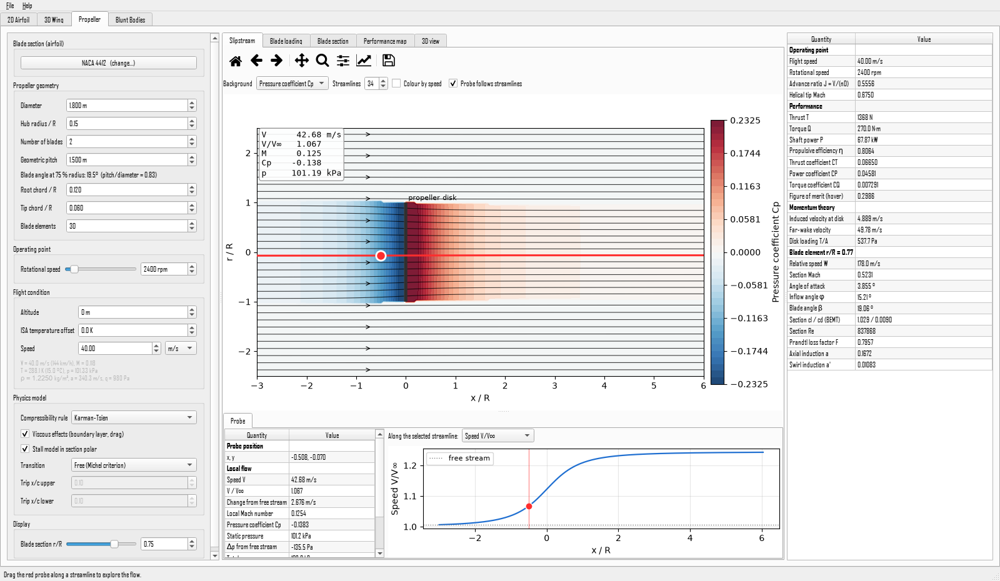
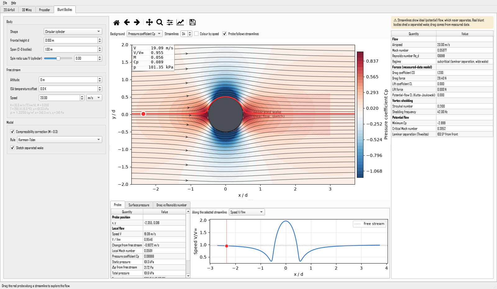

# Virtual Wind Tunnel

An interactive aerodynamics simulator for **airfoils, 3-D wings, propellers and blunt bodies**.
Change any setting and watch the streamlines, pressures and forces update. Drag a probe along a
streamline from the free stream up to the wing and see exactly how the speed, pressure, Mach number,
temperature and density change on the way.



## What it can do

| Tab | What you get |
|---|---|
| **2D Airfoil** | Streamlines, Cp / speed / Mach contours, lift CL, drag CD (friction, separation and wave parts), moment Cm, lift and drag forces, critical Mach number, boundary-layer transition and separation, stall, full polars |
| **3D Wing** | Vortex-lattice wing with taper, sweep, dihedral and twist. Tip-vortex streamlines, span loading compared with elliptic, induced drag, span efficiency, induced angle, wing stall, and the 2-D section at any span station *with the 3-D effects included* |
| **Propeller** | Blade-element momentum theory: thrust, torque, power, efficiency, CT / CP, tip Mach, figure of merit, loading along the blade, performance maps, slipstream streamlines and the flow around any blade section |
| **Blunt Bodies** | Cylinder (also spinning, for the Magnus effect), sphere, ellipses, square, diamond, plate, D-sections and triangles. Drag vs Reynolds number (drag crisis), vortex-shedding frequency, separation point and critical Mach number |

Other features:

* **Incompressible and compressible flow.** Choose Prandtl-Glauert, Kármán-Tsien or Laitone corrections.
  Supersonic airfoils use Busemann second-order theory and show the Mach waves. Above the critical Mach
  number a wave-drag estimate is added.
* **Draggable probe** on any streamline, with a live plot of the whole streamline (speed, Mach, Cp,
  pressure, temperature, density).
* **Airfoil library** with about 1,000 built-in airfoils: every common NACA 4-digit, 4-digit-modified and
  5-digit section (including reflexed ones), Joukowski, Kármán-Trefftz, supersonic biconvex and double
  wedge, flat and cambered plates. You can also type **any NACA code**, **import .dat files** (Selig or
  Lednicer format), or download the **UIUC database of about 1,650 airfoils** with one click.
* Atmosphere model (ISA up to 80 km), speed in m/s, km/h, knots, mph or Mach.

| | |
|---|---|
|  |  |
|  |  |

## Supported flow regimes

Each model works in the regimes below. The *Flow model* setting (Auto, Incompressible, Compressible)
picks the regime automatically from the Mach number, or you can force incompressible flow to compare.

**Mach-number regimes**

| Model | Incompressible<br>M < 0.3 | Subsonic compressible<br>0.3 ≤ M < M<sub>cr</sub> | Transonic<br>M<sub>cr</sub> ≤ M < 1 | Supersonic<br>M > 1 |
|---|---|---|---|---|
| **2D airfoil** | ✅ Panel method | ✅ Prandtl-Glauert, Kármán-Tsien or Laitone | ⚠️ Corrections + Lock wave drag (estimate); evaluated at M = 0.95 for 0.95–1.0 | ✅ Busemann 2nd-order theory with Mach waves (best for thin, sharp-nosed sections; evaluated at M = 1.08 for 1.0–1.08) |
| **3D wing** | ✅ Vortex lattice | ✅ Prandtl-Glauert / Göthert rule | ⚠️ Lock wave drag with sweep correction; capped at M = 0.95 | ❌ Not supported |
| **Propeller** | ✅ Blade-element momentum theory | ✅ Section lift corrected for each blade element's Mach number | ⚠️ Warning above tip Mach 0.85; correction capped at M = 0.9; no wave drag | ❌ Not supported (supersonic tips are shown in the blade-section view only) |
| **Blunt bodies (2D)** | ✅ Panel method + measured drag | ✅ Pressure-field corrections + measured drag rise | ⚠️ Field shown at M = 0.95; measured drag trend | ⚠️ Measured drag trend only (the bow shock is not modelled) |
| **Sphere (3D)** | ✅ Exact potential flow + Morrison drag correlation | ✅ Pressure-field corrections + measured drag rise | ⚠️ As for 2D bodies | ⚠️ As for 2D bodies |

✅ supported ⚠️ estimate (the app shows a warning) ❌ not available

**Physical effects**

| Effect | 2D airfoil | 3D wing | Propeller | Blunt bodies |
|---|---|---|---|---|
| Inviscid pressure field and streamlines | ✅ 2D | ✅ 3D lattice + 2D section view | ✅ Slipstream (actuator disk) + blade-section view | ✅ 2D, or axisymmetric for the sphere |
| Viscous drag (boundary layer) | ✅ Thwaites / Head | ✅ Strip-wise from the 2D polar | ✅ From the 2D polar | ✅ Measured CD(Re) |
| Laminar-turbulent transition | ✅ Free, forced, fully laminar or fully turbulent | ✅ From the section polar | ✅ From the section polar | ✅ Drag crisis near Re ≈ 3×10⁵ |
| Separation and stall | ✅ Kirchhoff trailing-edge stall | ✅ Wing stall, spanwise location | ✅ Blade stall, post-stall polar | ✅ Separation angle (Thwaites) |
| 3D effects | — | ✅ Induced drag, downwash, tip vortices, sweep, taper, twist, dihedral | ✅ Tip and hub losses (Prandtl) | ✅ Sphere vs cylinder |
| Rotation | — | — | ✅ RPM, advance ratio, swirl | ✅ Spinning cylinder (Magnus effect) |

---

## Installation guide

You need **Python 3.10 or newer** (3.12, 3.13 and 3.14 are fine). Everything else is installed for you.
Installation takes about 5 minutes and roughly 600 MB of disk space (mostly the Qt GUI library).

### Step 1: Install Python (skip if you already have it)

<details>
<summary><b>Windows</b></summary>

1. Go to <https://www.python.org/downloads/windows/>.
2. Under the newest **Python 3.13** or **3.14** release, click **"Windows installer (64-bit)"**.
   (Choose "ARM64" only if your PC has an ARM processor, such as a Snapdragon laptop.)
3. Run the installer. **On the first screen, tick "Add python.exe to PATH"**, then click **Install Now**.
4. At the end, click **"Disable path length limit"** if it is offered.
5. Open a *new* terminal (Start menu → type `cmd` → Command Prompt) and check the installation:
   ```
   python --version
   ```
   It should print something like `Python 3.14.x`.
</details>

<details>
<summary><b>macOS</b></summary>

1. Go to <https://www.python.org/downloads/macos/> and download the **macOS 64-bit universal2 installer**.
2. Open the `.pkg` file and follow the steps.
3. Open **Terminal** and check the installation:
   ```
   python3 --version
   ```
(Homebrew users can run `brew install python` instead.)
</details>

<details>
<summary><b>Linux (Ubuntu / Debian)</b></summary>

```bash
sudo apt update
sudo apt install python3 python3-venv python3-pip git libxcb-cursor0 libxkbcommon-x11-0 libegl1
```
The last three packages are needed by the Qt window system. Fedora: `sudo dnf install python3 xcb-util-cursor`.
</details>

### Step 2: Download the simulator

**Option A: Download a ZIP (no Git needed).** On the GitHub page, click the green **Code** button →
**Download ZIP**, then unzip it somewhere easy to find, such as your Documents folder.

**Option B: Clone with Git.**
```bash
git clone https://github.com/oreo7382/wind-tunnel-sim.git
cd wind-tunnel-sim
```

### Step 3: Install it (one click)

| System | What to do |
|---|---|
| **Windows** | Open the `scripts` folder and double-click **`install_windows.bat`** |
| **macOS / Linux** | In a terminal inside the project folder, run `bash scripts/install_mac_linux.sh` |

The installer creates a private Python environment in a `.venv` folder inside the project, so it does
not change anything else on your computer, and then installs numpy, matplotlib and PySide6.

### Step 4: Start the simulator

| System | What to do |
|---|---|
| **Windows** | Double-click **`scripts/run_windows.bat`** |
| **macOS / Linux** | `bash scripts/run_mac_linux.sh` |

The first start can take a few seconds while the libraries load.

### Step 5 (optional): Make a desktop icon

Create a **"Virtual Wind Tunnel"** icon that you can double-click to open the simulator directly:

| System | What to do | What you get |
|---|---|---|
| **Windows** | Double-click **`scripts/create_shortcut_windows.bat`** | A desktop shortcut and a Start menu entry (right-click it to *Pin to taskbar*) |
| **macOS** | `bash scripts/create_shortcut_mac_linux.sh` | `Virtual Wind Tunnel.app` on the desktop and in your *Applications* folder |
| **Linux** | `bash scripts/create_shortcut_mac_linux.sh` | A desktop launcher and an entry in your applications menu. If the desktop shows a text file, right-click it and choose *Allow Launching*. |

The icon points to this project folder, so create it again if you move the folder. Add `--no-menu`
to create only the desktop icon.

<details>
<summary><b>Manual installation (if you prefer typing the commands yourself)</b></summary>

From inside the project folder:

**Windows (Command Prompt or PowerShell)**
```
python -m venv .venv
.venv\Scripts\python -m pip install --upgrade pip
.venv\Scripts\python -m pip install -e .
.venv\Scripts\windtunnel
```

**macOS / Linux**
```bash
python3 -m venv .venv
.venv/bin/python -m pip install --upgrade pip
.venv/bin/python -m pip install -e .
.venv/bin/windtunnel
```

You can also install straight from GitHub without downloading anything first:
```bash
pip install git+https://github.com/oreo7382/wind-tunnel-sim.git
windtunnel
```
</details>

### Updating

Download the new ZIP (or run `git pull`), then run the install script again.

### Uninstalling

Delete the project folder, plus the desktop icon and menu entry if you made them. The only other thing
the simulator creates is a small `.windtunnel-sim` folder in your home directory (imported airfoils and
the optional UIUC database). Delete that too if you like.

---

## How to use it

1. **Pick a tab** at the top: *2D Airfoil*, *3D Wing*, *Propeller* or *Blunt Bodies*.
2. **Change settings** on the left: angle of attack, speed (in m/s, km/h, knots, mph or Mach), altitude,
   size, physics model and so on. Results update automatically.
3. **Drag the red probe** in the flow picture. It slides along the streamlines, so you can follow a
   particle of air from far upstream to the airfoil surface. The probe readout and the
   **"Along the selected streamline"** plot show the local speed, V/V∞, Mach number, Cp, static and total
   pressure, temperature and density. Click anywhere to jump the probe to the nearest streamline.
4. Untick **"Probe follows streamlines"** to place the probe anywhere. When you let go, a new streamline
   is traced through that point.
5. Use the **magnifier / hand** tools above the picture to zoom and pan. Click the tool again to return to
   probe mode. The house icon resets the view.
6. Change the **background** to show pressure coefficient, speed or local Mach number contours, and tick
   **"Colour by speed"** to colour the streamlines themselves.
7. Click the **airfoil name** to open the library: search, preview, type a NACA code, import a `.dat` file,
   or download the UIUC database.
8. **File → Save flow picture** exports the current plot as PNG, SVG or PDF.

### Ideas to try

* Increase the angle of attack on a NACA 2412 until the separation marker moves forward and the wing stalls.
* Set the speed to Mach 0.75 and compare the dashed (incompressible) and solid (compressible) Cp curves.
  Watch the probe report **"locally SUPERSONIC"** over the upper surface.
* Switch to a *Biconvex* or *Double wedge* airfoil at Mach 2 and look at the shock and expansion waves.
* In *3D Wing*, set taper to 1.0 and then 0.4 and compare the span loading with the elliptic curve.
  Add sweep and watch where the wing stalls first.
* In *Propeller*, set the speed to 0 (static thrust) and then increase it. Compute the performance map
  to find the best efficiency.
* Spin the cylinder (spin ratio 1–2) to see the Magnus effect move the stagnation points.
* Raise the cylinder Reynolds number past 3×10⁵ to see the **drag crisis**.

---

## Physics engine

The simulator uses fast engineering methods taught in aerodynamics courses. They don't solve the full
Navier-Stokes equations (no CFD), so every result appears instantly. Below are the governing equations
and corrections, with the Python file that implements each one. [docs/THEORY.md](docs/THEORY.md) gives the
full derivations, assumptions and validation.

### Atmosphere and free stream ([`atmosphere.py`](src/windtunnel/physics/atmosphere.py))

International Standard Atmosphere (layered lapse rates), ideal gas, and Sutherland's viscosity law:

```math
p = \rho R T,\qquad a = \sqrt{\gamma R T},\qquad \mu = \frac{1.458\times10^{-6}\,T^{3/2}}{T + 110.4},\qquad
M = \frac{V_\infty}{a},\qquad Re = \frac{V_\infty c}{\nu},\qquad q = \tfrac12 \rho V_\infty^2
```

### Inviscid flow: potential theory and the panel method ([`panel.py`](src/windtunnel/physics/panel.py))

Incompressible, irrotational flow satisfies Laplace's equation. The Hess-Smith panel method represents
the body with source panels plus a uniform vortex sheet, enforces zero normal velocity on every panel,
and applies the Kutta condition (equal tangential speeds at the trailing edge):

```math
\nabla^2 \phi = 0,\qquad \mathbf V \cdot \hat{\mathbf n} = 0 \text{ on the surface},\qquad
V_{t,\text{lower TE}} = -V_{t,\text{upper TE}}
```

```math
C_p = 1 - \left(\frac{V}{V_\infty}\right)^2,\qquad L' = \rho_\infty V_\infty \Gamma \quad\text{(Kutta-Joukowski)}
```

### Boundary layer and viscous drag ([`boundary_layer.py`](src/windtunnel/physics/boundary_layer.py))

All methods march the von Kármán momentum-integral equation along the surface:

```math
\frac{d\theta}{dx} + (2 + H)\frac{\theta}{u_e}\frac{du_e}{dx} = \frac{C_f}{2}
```

* **Laminar (Thwaites):** $\theta^2 = \dfrac{0.45\,\nu}{u_e^6}\displaystyle\int_0^x u_e^5\,dx$, with
  $\lambda = \dfrac{\theta^2}{\nu}\dfrac{du_e}{dx}$. Laminar separation occurs when λ < −0.09.
* **Transition (Michel):** $Re_\theta > 1.174\left(1 + \dfrac{22400}{Re_x}\right)Re_x^{0.46}$, or a
  trip strip / laminar separation.
* **Turbulent (Head's entrainment method + Ludwieg-Tillmann):**
  $\dfrac{d}{dx}(u_e\theta H_1) = 0.0306\,u_e\,(H_1 - 3)^{-0.6169}$ and
  $C_f = 0.246\cdot10^{-0.678H}\,Re_\theta^{-0.268}$. Separation is taken as H ≥ 2.0.
* **Profile drag (Squire-Young):** $c_d = 2\,\theta_{TE}\left(\dfrac{u_{e,TE}}{V_\infty}\right)^{(H_{TE}+5)/2}$,
  summed over both surfaces.
* **Stall (Kirchhoff / Beddoes-Leishman):** $c_l = c_{l,\text{inviscid}}\left(\dfrac{1+\sqrt f}{2}\right)^2$,
  where f is the separation point x/c, plus a small empirical boundary-layer "decambering" factor (≤ 7 %)
  ([`airfoil2d.py`](src/windtunnel/physics/airfoil2d.py)).

### Compressibility corrections ([`compressibility.py`](src/windtunnel/physics/compressibility.py))

The incompressible pressure coefficient $C_{p,0}$ is corrected point by point, with
$\beta = \sqrt{1-M_\infty^2}$:

```math
\text{Prandtl-Glauert: } C_p = \frac{C_{p,0}}{\beta}\qquad
\text{Kármán-Tsien: } C_p = \frac{C_{p,0}}{\beta + \dfrac{M_\infty^2}{1+\beta}\dfrac{C_{p,0}}{2}}\qquad
\text{Laitone: } C_p = \frac{C_{p,0}}{\beta + \dfrac{M_\infty^2\left(1+\frac{\gamma-1}{2}M_\infty^2\right)}{2\beta}C_{p,0}}
```

The critical Mach number is where the minimum corrected Cp reaches the sonic value:

```math
C_p^{*} = \frac{2}{\gamma M_\infty^2}\left[\left(\frac{2 + (\gamma-1)M_\infty^2}{\gamma+1}\right)^{\frac{\gamma}{\gamma-1}} - 1\right]
```

The probe's local state follows from isentropic relations with the free-stream total conditions
(incompressible mode: ρ and T constant, and $V = V_\infty\sqrt{1-C_p}$):

```math
\frac{p_0}{p} = \left(1 + \frac{\gamma-1}{2}M^2\right)^{\frac{\gamma}{\gamma-1}},\qquad
\frac{T_0}{T} = 1 + \frac{\gamma-1}{2}M^2,\qquad p = p_\infty + q_\infty C_p
```

* **Transonic wave drag (Lock's 4th-power law):** $c_{d,w} = 20\,(M_\infty - M_{cr})^4$, capped at 0.1.
  Supersonic pockets are limited to local M ≤ 1.6.
* **Compressible skin friction:** reduced by $(1 + 0.144M^2)^{-0.65}$.

### Supersonic airfoils ([`flowfield.py`](src/windtunnel/physics/flowfield.py))

Busemann's second-order thin-airfoil theory. δ is the local flow deflection, and disturbances travel
along Mach lines at angle μ:

```math
C_p = \frac{2}{\beta}\,\delta + \frac{(\gamma+1)M_\infty^4 - 4\beta^2}{2\beta^4}\,\delta^2,\qquad
\beta = \sqrt{M_\infty^2 - 1},\qquad \mu = \arcsin\frac{1}{M_\infty}
```

### 3D wings: vortex-lattice method ([`wing3d.py`](src/windtunnel/physics/wing3d.py))

Horseshoe vortices (Biot-Savart law) satisfy the flow-tangency condition at each panel's ¾-chord control
point. Compressibility uses the Göthert rule (geometry stretched by 1/β in x). Induced drag is computed
in the Trefftz plane far behind the wing:

```math
d\mathbf V = \frac{\Gamma}{4\pi}\,\frac{d\mathbf l \times \mathbf r}{|\mathbf r|^3},\qquad
(\mathbf V_\infty + \mathbf v_{\text{ind}})\cdot\hat{\mathbf n}_i = 0,\qquad x' = \frac{x}{\beta}
```

```math
C_L = \frac{2}{V_\infty S}\sum_j \Gamma_j\,\Delta y_j,\qquad
C_{D_i} = -\frac{1}{V_\infty^2 S}\sum_j \Gamma_j\, w_{T,j}\,\Delta s_j,\qquad
e = \frac{C_L^2}{\pi\,AR\,C_{D_i}},\qquad \alpha_i = -\frac{w_T}{2V_\infty}
```

Each strip's lift is then iterated onto its 2D viscous polar at the effective angle
$\alpha_{\text{eff}} = \alpha + \text{twist} - \alpha_i$, which gives wing stall and profile drag.

### Propellers: blade-element momentum theory ([`propeller.py`](src/windtunnel/physics/propeller.py))

Blade-element forces are balanced against momentum theory in each annulus, including Prandtl's tip and
hub loss factor F. W is the relative speed at the blade and φ the inflow angle:

```math
dT = B\,\tfrac12\rho W^2 c\,(c_l\cos\phi - c_d\sin\phi)\,dr = 4\pi r\rho F\,V_a (V_a - V_\infty)\,dr
```

```math
dQ = B\,\tfrac12\rho W^2 c\,(c_l\sin\phi + c_d\cos\phi)\,r\,dr,\qquad
F = \frac{2}{\pi}\arccos\!\left[\exp\!\left(-\frac{B(R-r)}{2r\sin\phi}\right)\right]
```

```math
J = \frac{V_\infty}{nD},\qquad C_T = \frac{T}{\rho n^2 D^4},\qquad C_P = \frac{P}{\rho n^3 D^5},\qquad
\eta = \frac{T V_\infty}{P},\qquad T = 2\rho A (V_\infty + v_i)\,v_i \;\text{(actuator disk)}
```

### Blunt bodies ([`bluntbody.py`](src/windtunnel/physics/bluntbody.py))

Potential flow gives the pressure field, for example $C_p = 1 - 4\sin^2\theta$ on a cylinder. A spinning
cylinder carries circulation $\Gamma = 2\pi a^2\omega$, so $c_l = 2\pi\,\omega a / V_\infty$. Potential flow
has zero drag (d'Alembert's paradox), so drag comes from measured data: the cylinder CD(Re) curve, the
Morrison sphere correlation and Hoerner/White tables. Vortex shedding uses $f = St\,V_\infty / d$.

### Accuracy

The models are validated against exact solutions and published wind-tunnel data (see `tests/`).
Typical accuracy is a few percent for lift and moment in attached flow, 10–20 % for drag, and roughly
±15 % for maximum lift. Transonic shocks, deep stall and separated wakes are only estimated, and the app
warns you when you are in those regimes. **This is a learning tool, not certified design software.**

---

## Troubleshooting

| Problem | Fix |
|---|---|
| `python` is not recognized / Microsoft Store opens (Windows) | Reinstall Python and tick **"Add python.exe to PATH"**. Or go to *Settings → Apps → Advanced app settings → App execution aliases* and turn off the two "python" aliases. |
| `ModuleNotFoundError: No module named 'pip._vendor...'` or very long path errors (Windows) | Run the Python installer again → *Modify* → enable **"Disable path length limit"**, or move the project to a shorter folder such as `C:\wind-tunnel-sim`. |
| `No matching distribution found for PySide6` | Your Python is too new or too old for the Qt library. Install Python 3.12 or 3.13. |
| Linux: `Could not load the Qt platform plugin "xcb"` | `sudo apt install libxcb-cursor0 libxkbcommon-x11-0 libegl1` |
| macOS: "cannot be opened because the developer cannot be verified" | Run the scripts from Terminal with `bash scripts/...` rather than double-clicking them. |
| `error: externally-managed-environment` | Use the install script, or create the virtual environment as in the manual instructions. Don't install into the system Python. |
| The window is very slow | Reduce the number of streamlines or panels, or turn off "Show tip-vortex streamlines" on the 3D tab. |
| UIUC download fails | Check your internet connection. You can also download `coord_seligFmt.zip` from <https://m-selig.ae.illinois.edu/ads/coord_database.html> manually and use *Import .dat file*. |

---

## For developers

```bash
pip install -e ".[test]"
pytest                       # physics validation, shortcut maker and an off-screen GUI smoke test
```

```
src/windtunnel/
  physics/          all aerodynamics (no GUI code; usable from scripts and notebooks)
    atmosphere.py     ISA atmosphere, free-stream state
    geometry.py       airfoil storage, splines, repanelling
    naca.py, shapes.py, library.py   airfoil families, blunt bodies, library and .dat import
    panel.py          Hess-Smith panel method
    boundary_layer.py Thwaites + Michel + Head + Squire-Young
    compressibility.py, flowfield.py  corrections, local state, streamline tracing
    airfoil2d.py      complete 2-D analysis (all regimes)
    wing3d.py         vortex-lattice wing
    propeller.py      blade-element momentum theory + actuator-disk slipstream
    bluntbody.py      blunt-body models
  gui/              PySide6 + matplotlib user interface
  shortcut.py       desktop shortcut / app-menu entry for Windows, macOS and Linux
  assets/           app icon
tests/              pytest suite
scripts/            one-click install / run scripts
```

The physics package can be used without the GUI:

```python
from windtunnel.physics import naca, airfoil2d as a2
from windtunnel.physics.atmosphere import isa, Freestream

section = a2.Section(naca.from_code("2412"))
result = a2.analyze(section, Freestream(isa(1000), 60.0), a2.Settings(alpha_deg=5, chord=1.2))
print(result.cl, result.cd, result.lift_per_span)
```

GitHub Actions installs the project on Windows, macOS and Linux with several Python versions and runs the
tests, and also runs the one-click install scripts, on every push.

## Credits and license

Created by [oreo7382](https://github.com/oreo7382). Released under the [MIT License](LICENSE).

The UIUC Airfoil Coordinates Database is maintained by Michael Selig's group at the University of Illinois.
It is **not** bundled with this project. The app downloads it to your computer only when you ask it to.
